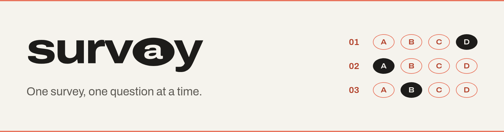
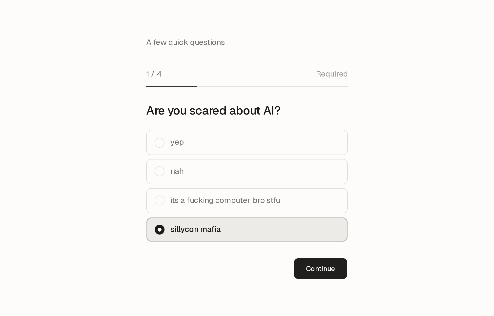

<h1><picture>
  <source media="(prefers-color-scheme: dark)" srcset=".github/header-dark.png">
  
</picture></h1>

A small, calm survey you can host yourself. One survey per deploy: people answer one question at a time, and you edit questions and read results from a password-protected dashboard.



- Four question types: multiple choice, checkboxes, rating, text
- Keyboard friendly, resumable on refresh, works on phones
- Results with bars and averages, CSV export
- Next.js, Postgres, Drizzle

## Deploy

[](https://vercel.com/new/clone?repository-url=https%3A%2F%2Fgithub.com%2FAVGVSTVS96%2Fsurvay&env=ADMIN_PASSWORD&envDescription=Password%20for%20%2Fadmin.%20Use%20a%20long%20random%20one.&products=%5B%7B%22type%22%3A%22integration%22%2C%22protocol%22%3A%22storage%22%2C%22productSlug%22%3A%22neon%22%2C%22integrationSlug%22%3A%22neon%22%7D%5D)

The button adds a Neon database and asks for `ADMIN_PASSWORD`. Use a long random password (`openssl rand -base64 24`): it's the only thing guarding `/admin`, and changing it signs everyone out. For extra safety, add a [Vercel Firewall](https://vercel.com/docs/vercel-firewall) rate limit rule on `/admin/login`.

Then create the tables once, from a clone of your repo: `vercel env pull .env.local && pnpm install && pnpm db:push`.

## Run locally

```sh
cp .env.example .env.local   # set DATABASE_URL and ADMIN_PASSWORD
pnpm install && pnpm db:push && pnpm db:seed
pnpm dev                     # survey at /, dashboard at /admin
```

`db:seed` adds a demo survey when there are no questions yet.

## Options

| Env | What it does |
| --- | --- |
| `PUBLIC_RESULTS=1` | Shows everyone the results on `/results` and after they submit. Text answers stay private. |

Add `?embed=1` to `/` or `/results` to drop the page padding and post the page height to the parent window as `{ type: "survay:height", height }`, for showing it in an iframe.

## License

MIT
